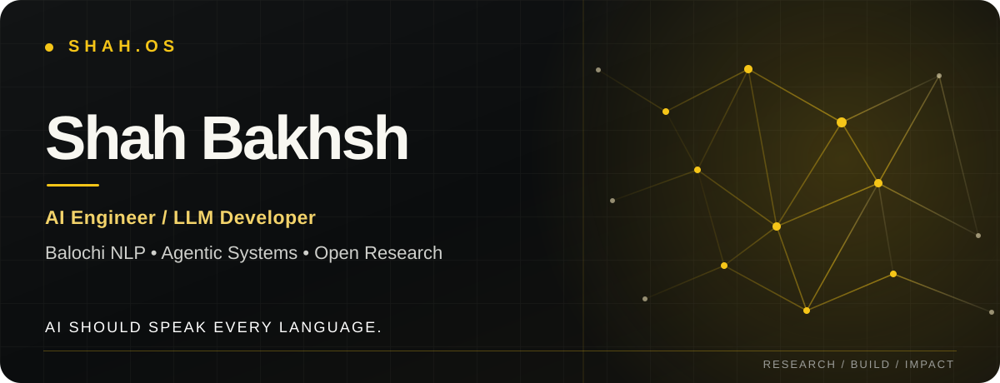

<!--
  SHAH.OS / GitHub Profile
  Original editorial design for Shah Bakhsh.
  Research outcomes below are reported by their linked repositories.
-->

<div align="center">



<br/>


<br/>

### Building intelligent systems. Advancing language technology.

I build at the intersection of **LLMs, natural language processing, and agentic AI**,  
with a long-term mission to make language technology more accessible to **Balochi** and other underrepresented languages.

<br/>

<a href="https://shahbakhsh.tech"></a>
<a href="https://shahbakhsh.tech/research/"></a>
<a href="https://www.linkedin.com/in/shah-bakhsh/"></a>
<a href="mailto:shahbakhshtech@gmail.com"></a>

</div>

<br/>

## 01 / About

I'm **Shah Bakhsh**, an AI engineer and LLM developer exploring the intersection of **language models, applied machine learning, and practical AI systems**.

My research focus is **Balochi NLP**—from text preparation and tokenization to language representations, part-of-speech tagging, named-entity recognition, and developer tooling.

I care about research that can be examined and built upon: documented experiments, clear evaluation methods, transparent limitations, and useful open-source implementations.

```text
CURRENT FOCUS
  01  Low-resource language technology
  02  Large language models and model adaptation
  03  AI agents, retrieval, and developer workflows
  04  Research-to-product engineering
```

<div align="center">

</div>

<br/>

## 02 / Featured research

**Balochi AI Lab** · Language representation → Language infrastructure → Linguistic understanding

<table>
<tr>
<td width="50%" valign="top">

### [BalBERT ↗](https://github.com/shah-bakhsh/BalBERT)
**Foundational language representations**

Domain-adaptive XLM-RoBERTa training for Balochi, supporting continued experimentation with low-resource language models.

**Reported:** ~97.8% lower MLM perplexity against the project's stated baseline.

[Read the research brief →](https://shahbakhsh.tech/research/balbert/)

</td>
<td width="50%" valign="top">

### [BalPOS ↗](https://github.com/shah-bakhsh/BalPOS)
**Part-of-speech understanding**

A transformer-based Balochi POS tagging system built around 16 Universal Dependencies tags.

**Reported:** 87.26% held-out accuracy · 87.22% weighted F1 (v2).

[Read the research brief →](https://shahbakhsh.tech/research/balpos/)

</td>
</tr>
<tr>
<td width="50%" valign="top">

### [BalNER ↗](https://github.com/shah-bakhsh/BalNER)
**Named-entity recognition**

Experiments in recognizing and classifying named entities in Balochi text.

**Reported:** 0.7034 entity-level F1 on the documented test set.

[Read the research brief →](https://shahbakhsh.tech/research/balner/)

</td>
<td width="50%" valign="top">

### [BalTokenizer ↗](https://github.com/shah-bakhsh/BalTokenizer)
**Language infrastructure**

A 48K Unigram tokenizer configuration tailored to Balochi text.

**Reported:** 99.9% character coverage · 0.0% unknown-token rate in the evaluated text.

[Read the research brief →](https://shahbakhsh.tech/research/baltokenizer/)

</td>
</tr>
</table>

<sub>**Research integrity:** All figures above come from the linked repositories and their documented evaluation conditions. They are not independent benchmarks or guarantees of general-domain performance.</sub>

**Beyond the models:** [BalNLP](https://github.com/shah-bakhsh/BalNLP) brings components together through Python/FastAPI and right-to-left tooling; [BalOCR](https://shahbakhsh.tech/research/balocr/) is an ongoing research direction without a public quality metric.

**[Explore the full Balochi NLP research library →](https://shahbakhsh.tech/research/)**

<br/>

## 03 / Engineering projects

| Project | Area | What I'm exploring |
| :--- | :--- | :--- |
| **[SHAH.OS](https://github.com/shah-bakhsh/shah-bakhsh-shah-os)** | Portfolio engineering | A Next.js research portfolio with interactive UI, documented case studies, and professional links |
| **[CrisisPilot AI](https://github.com/shah-bakhsh/CrisisPilot-AI)** | Agentic systems | Multi-agent workflows for emergency intelligence and coordination; concept/exploration |
| **[PathPilot AI](https://github.com/shah-bakhsh/pathpilot-ai)** | Applied AI | Personalized career navigation and AI-assisted guidance; concept |
| **[ReelForge](https://github.com/shah-bakhsh/reelforge)** | Local AI tools | Experimental video clipping using speech, vision, and local model workflows |

<div align="center">
<a href="https://shahbakhsh.tech/projects/"><strong>View selected projects and case studies ↗</strong></a>
</div>

<br/>

## 04 / Technical toolkit

**AI & language engineering**


**Application & developer engineering**


<sub>Areas of exploration include XLM-RoBERTa adaptation, token classification, RAG, agentic workflows, model evaluation, and API-based integrations.</sub>

<br/>

## 05 / My professional home

<div align="center">

### [SHAH.OS — shahbakhsh.tech](https://shahbakhsh.tech)

**One place for my research, projects, and collaborations.**

[About me](https://shahbakhsh.tech/about/) · [Research](https://shahbakhsh.tech/research/) · [Projects](https://shahbakhsh.tech/projects/) · [Contact](https://shahbakhsh.tech/contact/)

</div>

<br/>

## 06 / GitHub activity

<div align="center">

**Consistent progress. Real contributions.**

<a href="https://github.com/shah-bakhsh?tab=overview">
  
</a>

<br/>

[**Explore my GitHub contribution history ↗**](https://github.com/shah-bakhsh?tab=overview)

<sub>Streak information is retrieved live and may be temporarily unavailable if the image service is down. GitHub itself is the source of truth for contribution activity.</sub>

</div>

<br/>

### AI Research Journal

[**Explore daily AI research notes and open-source opportunities ↗**](https://github.com/shah-bakhsh/shah-bakhsh/tree/main/docs/presence)

<sub>Automated, source-linked research briefs with transparent AI assistance. External community contributions are reviewed before publication.</sub>

<br/>

## 07 / Let's connect

I'm interested in thoughtful collaboration around **Balochi language technology, low-resource NLP, LLM engineering, and useful agentic systems**.

<div align="center">

[**Website**](https://shahbakhsh.tech) &nbsp;·&nbsp; [**LinkedIn**](https://www.linkedin.com/in/shah-bakhsh/) &nbsp;·&nbsp; [**Hugging Face**](https://huggingface.co/shah-bakhsh) &nbsp;·&nbsp; [**Kaggle**](https://www.kaggle.com/shahbakhshtech) &nbsp;·&nbsp; [**Email**](mailto:shahbakhshtech@gmail.com)

<br/>

**AI should speak every language.**

<sub>SHAH.OS © 2026 Shah Bakhsh · Designed for clarity, research, and real-world impact.</sub>

</div>
